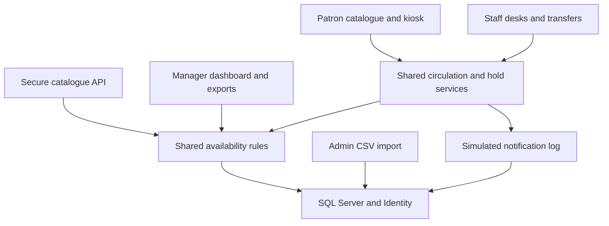

# Integrated architecture and user journeys

TopEndLibraryHub uses one ASP.NET Core MVC application and one SQL Server database for its seven assignment expansions. Different access channels share circulation and availability rules so that a copy reserved or moving between branches cannot be offered as ordinary stock elsewhere.

## Integration responsibilities

| Expansion | Entry point | Shared contract | Outcome |
| --- | --- | --- | --- |
| Self-service kiosk | KioskController | IdentityUserId links one login to its Borrower; CirculationService and HoldPlacementService enforce ownership and stock rules | Private loans/requests, checkout and two-minute session reset |
| Secure API | CatalogueApiController and API-key middleware | CirculationRules.GenerallyAvailable; GET-only projections and private external credential | Search, available copies, categories and health/configured branch status |
| Automated messages | NotificationService and background worker | Unique EventKey/Channel; UTC storage and Darwin display | Simulated Email/SMS loan, reminder, fine and pickup records |
| Branches and transfers | StaffLocationController and TransfersController | Active branch/desk; per-item transaction; InTransit=5 preserves earlier status values | Dispatch at source, receive at destination, protect reservation |
| Holds | HoldsController and patron Kiosk/Hold | One active request per borrower/item; FIFO CreatedAtUtc/Id; one allocation per item | Waiting, allocated, ready and collected progression |
| CSV importer | CsvImportController | Book inheritance, required PublicationYear, Quantity physical copies, selected active branch | Valid rows become separately coded copies; skipped rows have reasons |
| Manager reporting | ManagerReportingService and ManagerReportExport | Same general availability as catalogue/API; recorded fines separate from current estimates | Dashboard, CSV and PDF reconcile to fine/inventory audit rows |

A physical Available status is not sufficient for general borrowing. Active loans, transfers, usable allocations and eligible waiting requests are considered. The rightful Ready member can collect while later requests remain waiting. SQL Server locking and filtered unique indexes protect circulation; the separate real-provider tests still require execution on Windows.

## Family pickup journey

| Stage | User need and action | System response | Evidence |
| --- | --- | --- | --- |
| Discover | Find a borrowed/damaged item and select Join waiting list | Explain availability; retain item code through login | Existing catalogue/hold evidence and shared source |
| Request | Linked active member chooses pickup branch | Create own request; reject duplicate; show private FIFO position | Earlier Sky/Asha/Noah results and indexed captures |
| Prepare | Staff return/repair the item | Allocate next eligible request; do not announce pickup at the wrong branch | Existing repair/allocation and zero-notice captures |
| Move | Staff dispatch and receive at pickup branch | InTransit blocks borrowing; destination receipt makes request Ready | Harsimran's component captures and lead integration evidence |
| Collect | Rightful member checks out at physical branch | Fulfil allocation, create one loan and record simulated confirmation | Earlier staff collection evidence; final SQL kiosk/concurrency checks pending |
| Reuse | Return a usable copy | Record any late fine, then promote next eligible request | Earlier queue results; production fine test and pending SQL return test |

## Import and management journey

An administrator selects an active branch and uploads the documented CSV. Quantity=2 produces two copies with unique library codes. Missing headers reject the upload; invalid rows explain their errors; re-uploading an existing ISBN skips it. The manager then reviews the same collection through the dashboard, CSV and PDF. Reserved/transit items remain unavailable to the general public. Fine audits identify each loan, amount, payment state and payment timestamp; current overdue estimates remain separate. Inventory audits explain each copy's branch, status, restriction and general availability.

The automated synthetic fixture checks these calculations and generates an inspected two-page PDF. Windows upload, exported files, route access and SQL transactions remain final release checks. See [release verification](RELEASE_CHECKS_16OCT.md), [the screenshot index](screenshots/README.md) and [the import/report guide](IMPORT_AND_REPORT_GUIDE.md). All captures retain their historical dates and evidence limits.
