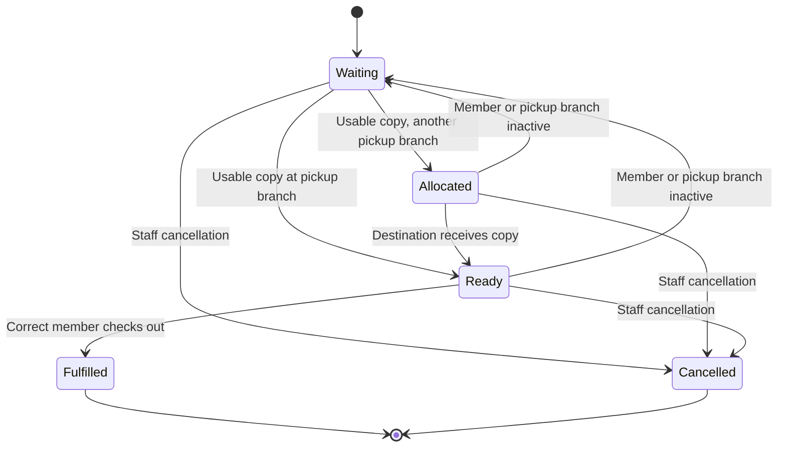

# Integration and user journeys

Prepared 14 October 2026 for the circulation patch. These diagrams describe the integrated source. Main circulation outcomes are reported in the test record; kiosk/API, concurrency and final seven-module acceptance remain pending. They are inputs to the required final portfolio, not the final PDF.

## Shared circulation

Reception and the authenticated kiosk call CirculationService. It validates member/location/item state, acquires the same transaction-owned per-item SQL application lock, refreshes the hold queue, and commits loan/item/hold changes together. Transfer dispatch/receipt and authorised stock edits use that item lock and HoldWorkflowService. A filtered unique active-loan index is the final duplicate guard.

Public catalogue, kiosk cards and API use CirculationRules for ordinary availability. Physical Available does not override an allocation. The API exposes catalogue projections only, behind an external API key. The notification worker catches up allocation and simulated messages every minute while the app runs, then source-state checks and a unique event/channel index protect its log.

## Pickup state transitions

Cancelled/fulfilled requests remain history. Queue eligibility uses active member + active pickup branch, ordered CreatedAtUtc then Id. Damaged stock is allocated only after an authorised repair; in-transit stock is not ready. Cancellation at an unsuitable physical branch may allocate the next request for another protected transfer.

## Repair-to-pickup journey

| Stage | Person and goal | Action and feedback | Meaningful benefit | Evidence |
| --- | --- | --- | --- | --- |
| Find | Family wants a reusable toy | Search title/code, check condition and location. | Avoid a wasted visit for an unusable or reserved copy. | Final UI retest pending |
| Request | Patron wants fair access | Staff create a hold with chosen pickup branch; show waiting position. | Order is visible and duplicate requests cannot jump the queue. | Borrowed-case H01–H02 observed; damaged-case C07 reported |
| Repair | Admin restores the damaged copy | Edit repaired condition to Available; queue head becomes Allocated. | Repair releases the existing queue without a second request. | C07 rejection photo; C08 allocation/no early notice reported |
| Move | Reception delivers to pickup location | Dispatch from Darwin; receive only at Palmerston. | Reservation survives transport; no premature pickup message. | C09–C11 dispatch/guards/first receipt reported |
| Collect | Correct member wants the reserved toy | Linked kiosk or staff checkout fulfils the allocation. | Later members cannot take a reserved copy. | C12 staff collection reported; C15 kiosk pending |
| Reuse | Next waiting family wants access | Return in usable condition; next eligible request becomes Ready. | The queue continues fairly after borrowing. | C01 ready photo; C04–C06/C12 handover reported |

## Demonstrated lead journey

Kamalpreet created Asha and Noah holds on borrowed TY-0001 at Darwin. The duplicate was rejected; positions were Asha 1 / Noah 2. Cancelling Asha retained her history and promoted Noah to 1. Five screenshots at dbbc540 support those three UI outcomes. Those five images cover the initial desk case. The subsequent TY-9001 run reports repair, protected transfer, staff collection, next-family handover and a return requiring repair. Pickup totals progressed 0 → 2 → 4 → 6, then stayed six after restart. The additional captures are still being matched to their filenames; kiosk/private ownership and other unrun cases remain pending.

## Other breadth features

Import and expanded management reports still await Sandesh's verified handoff. Their final integration diagram must identify actual routes, shared models, import validation and reporting reconciliation after the source is received. Do not present planned modules or draft PDF exports as implemented.
